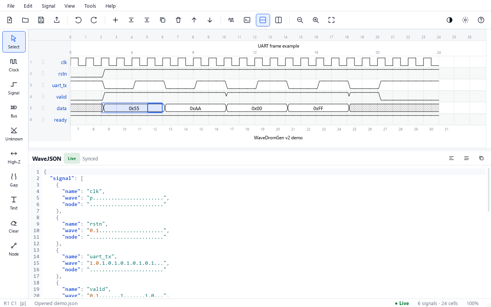
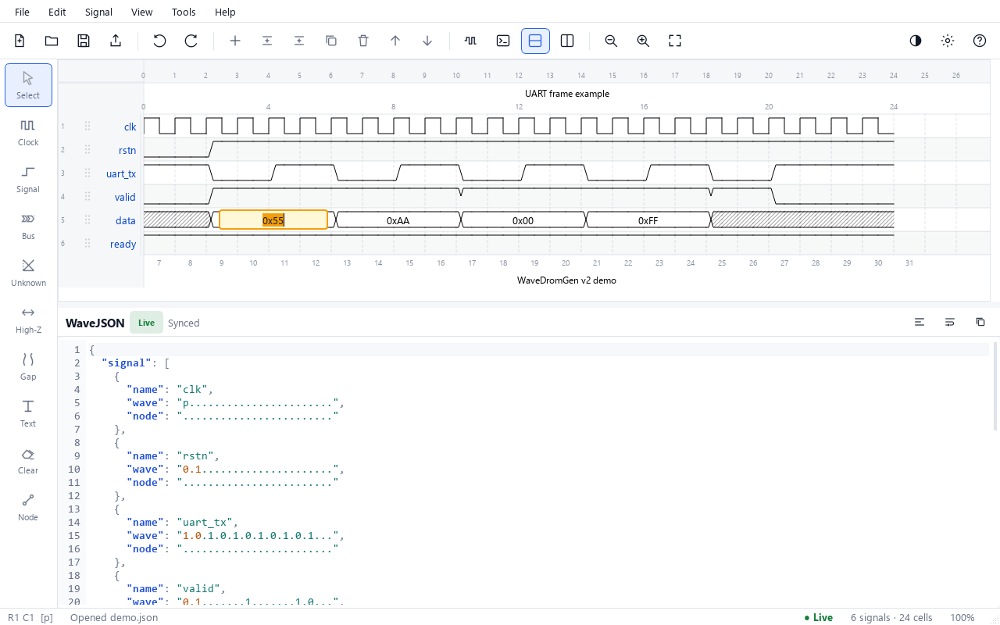
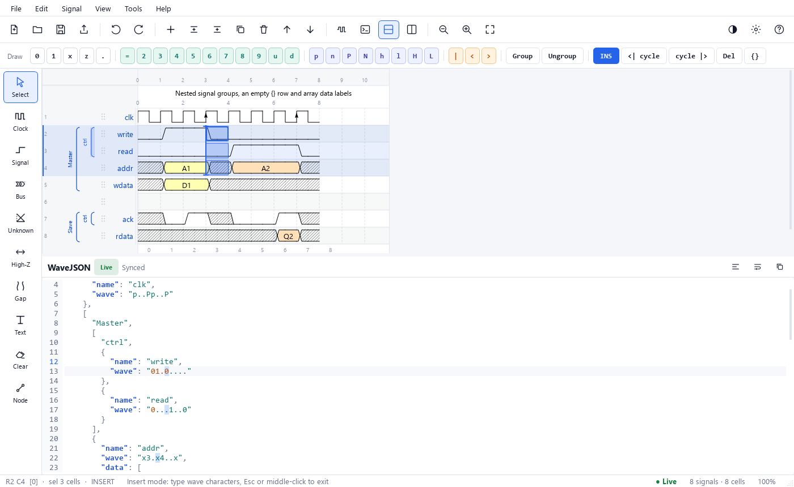
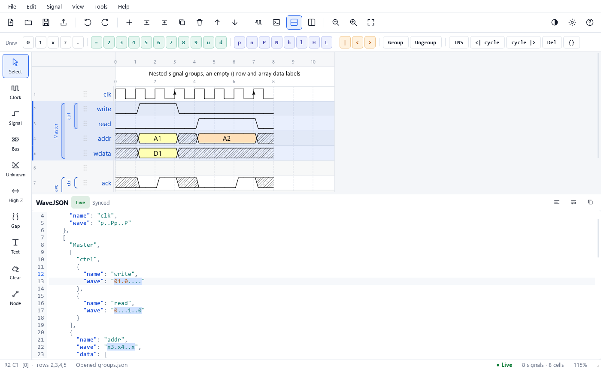
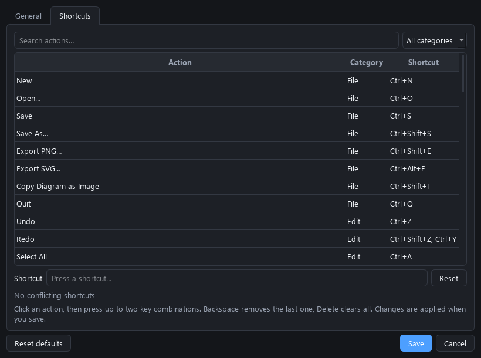
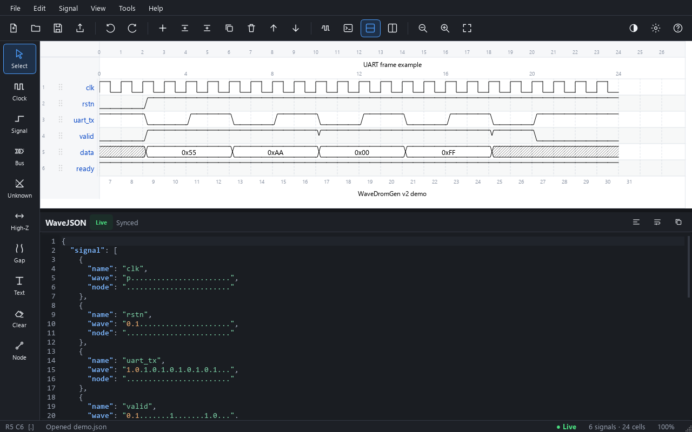
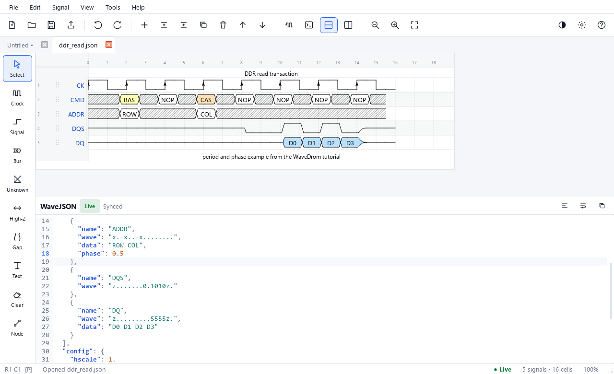

<p align="center"></p>

# WaveDromGen v2.3

**基于 Qt 的图形化数字时序图编辑器，兼容 WaveDrom 渲染，支持 JSON 实时双向同步与直接编辑波形。**



WaveDromGen 让你既能像 WaveDrom 一样写 WaveJSON，也能像绘图工具一样直接点击、框选和拖动波形。波形渲染使用 WaveDrom 官方皮肤几何与符号，导出的图与 WaveDrom 一致，同时每个单元格都可以交互编辑。

> English documentation: [README.md](README.md)

---

## 主要特性

| | 功能 |
|---|---|
| ✏️ | **双击直接编辑文字**：双击信号名或总线 `data` 标签即可输入；<kbd>Enter</kbd> 跳到下一个**信号名**，<kbd>Tab</kbd> 跳到下一个 **data 标签**，<kbd>Esc</kbd> 取消。 |
| ↕️ | **拖动排序**：按住左侧行号区域上下拖动信号，蓝色插入线显示目标位置；长信号名不会再把拖动手柄挤偏。 |
| ↔️ | **上下/左右分栏**：波形与 JSON 编辑器可上下、左右分栏或单独显示；合法 JSON 实时渲染到波形，波形编辑实时更新 JSON。 |
| 🗂️ | **多标签编辑**：同时打开多个 WaveJSON 文件，每个标签保留自己的编辑器内容、选区、缩放与滚动位置，信号和分组可在标签间复制粘贴。 |
| ⏱️ | **时钟自适应**：名称包含 `clk`/`clock` 的信号跟随最长信号，既可自动变长，也会在最长信号变短时自动缩短。 |
| 🧩 | **信号分组**：选中信号后按 <kbd>Ctrl</kbd>+<kbd>G</kbd> 建立命名分组；支持嵌套分组、点击分组括号选中整组，以及整组的复制、粘贴、删除、克隆、排序与取消分组。也支持 `{}` 空行。 |
| ➕ | **信号增删改**：添加、插入、删除、复制、粘贴、清空一条波形，全部提供可配置快捷键；新信号长度与 clk 一致，<kbd>Ctrl</kbd>+<kbd>Enter</kbd> 新建后直接编辑信号名。 |
| 🖱️ | **框选 + 波形字符**：拖动选择任意单元格区域（包括波形末尾之外的空白 cycle），直接输入 `0 1 x z = u d p P n N l L h H 2..9 \| .` 等 WaveDrom 字符完成批量编辑；矩形块可整体复制/粘贴，<kbd>Ctrl</kbd>+<kbd>C</kbd>/<kbd>V</kbd> 会按选区自动判断复制波形块还是信号。 |
| ⏹️ | **波形周期删除/插入**：<kbd>Del</kbd> 真正删除选中的 cycle，<kbd>Ctrl</kbd>+<kbd>Shift</kbd>+<kbd>←</kbd>/<kbd>→</kbd> 在选区前后插入，鼠标中键切换插入模式后可连续输入；画布上方提供按电平/总线/时钟/特殊分组的彩色波形按钮面板和分组/取消分组按钮。 |
| 🎯 | **插入光标与多行插入**：插入模式用竖线光标高亮目标周期；按住鼠标中键拖动可选中多行信号，输入时同时插入到所有选中行，编辑器只高亮这些信号对应的 `wave` 字符串。 |
| 🎛️ | **波形图设置**：图形界面配置皮肤、`hscale`、`head`/`foot` 文本与 `tick`/`tock`/`every`；`period`/`phase` 可从右键菜单快速修改，首选项等设置项已完整中文化。 |
| ⌨️ | **快捷键可配置**：72 个操作，支持按键捕获、冲突检测、恢复默认并保存到配置文件。 |
| 🎨 | **GUI 优化**：浅色/深色主题（深色模式自动切换 dark 波形皮肤）、中英文界面、缩放、时间标尺、选中高亮、右键菜单、最近文件、工具栏与工具侧栏。 |
| 🧩 | **兼容 WaveJSON**：支持嵌套信号分组、`{}` 空行、`period`、`phase`、字符串或数组 `data`、`node`、`edge` 箭头/折线、JSONML `head`/`foot`，并保留未知字段。 |
| 🪶 | **轻量编辑器**：行号、当前行高亮、JSON/JSON5 语法高亮、智能缩进、查找替换、格式化、错误行标记。 |




---

## 安装与运行

需要 **Python 3.10+**。

```bash
git clone https://github.com/Nymph-K/wavedromgen.git
cd wavedromgen
python -m pip install -r requirements.txt
python main.py
```

直接打开示例：

```bash
python main.py examples/demo.json
```

Windows 下可打包为单文件 exe：

```bash
python -m pip install pyinstaller
python package2exe.py
```

生成文件位于 `dist/WaveDromGen.exe`。预编译的 Windows 版本可从 [Releases](https://github.com/Nymph-K/wavedromgen/releases) 下载。

---

## 使用说明

### 1. 名称与数据标签

双击信号名或总线标签，或按 <kbd>F2</kbd>：

- <kbd>Enter</kbd>：提交并编辑下一个**信号名**；
- <kbd>Tab</kbd>：提交并编辑下一个 **data 标签**；
- <kbd>Shift</kbd>+<kbd>Enter</kbd> / <kbd>Shift</kbd>+<kbd>Tab</kbd>：反向跳转；
- <kbd>Esc</kbd>：取消。

两类字段之间仍可互相到达：在信号名上按 <kbd>Tab</kbd> 会进入该信号的 data 标签，在 data 标签上按 <kbd>Enter</kbd> 会到达下一个信号名。通过界面编辑的 `data` 会写成 WaveJSON 数组，例如 `"data": ["head", "body", "tail"]`。

空的 bus 段会显示虚线的 `data` 占位符，双击即可创建标签。

### 2. 框选波形单元格

单击单元格、拖动框选，或使用 <kbd>Shift</kbd>+方向键 / <kbd>Ctrl</kbd>+<kbd>A</kbd> 扩展选择。波形末尾之外的空 cycle 也可以选中：继续向右拖动时画布会自动加宽并滚动，直接输入即可扩展该信号。直接键入 WaveDrom 字符会写入所有选中单元格：

| 字符 | 含义 |
|---|---|
| `0` / `1` | 低电平 / 高电平 |
| `.` | 保持前一个状态 |
| `x` / `z` | 未知态 / 高阻态 |
| `=` | 数据总线（对应一个 `data` 标签） |
| `2`–`9` | 带颜色的数据总线 |
| `p`/`P`, `n`/`N` | 上升沿/下降沿时钟；大写带边沿标记 |
| `l`/`L`, `h`/`H` | 时钟低/高相位；大写带边沿标记 |
| `u` / `d` | 总线上升/下降过渡 |
| `\|` | 间隔标记 |
| `<` / `>` | 子周期（尖锐）跳变 |

单选单元格时，输入任意波形字符后都会自动前进到下一格（即使字符与当前格相同）；可在 **首选项 → 行为** 中关闭“输入任意波形字符后跳到下一周期”。<kbd>Ctrl</kbd>+<kbd>C</kbd> / <kbd>Ctrl</kbd>+<kbd>V</kbd> 会根据选区自动判断：选中波形块时按矩形块复制粘贴（复制 3×2 的块会原样粘贴为 3×2，把单行块粘贴到单个单元格时会连续填入多个 cycle）；选中信号行时复制/粘贴完整的 WaveJSON 信号对象。**编辑 → 复制单元格 / 粘贴单元格** 仍然强制按波形块处理。

画布上方的 **波形按钮面板** 按图中格式分组并着色：电平（`0 1 x z .`）、总线（`= 2 3 4 5 6 7 8 9 u d`）、时钟（`p n P N h l H L`）、特殊（`| < >`），并带有“绘制”标签；面板还提供 **分组 / 取消分组**、左/右插入周期、删除周期、`{}` 空行和插入模式按钮。

### 3. 删除与插入波形周期

| 操作 | 默认快捷键 |
|---|---|
| 删除选中 cycle（后续波形左移） | <kbd>Del</kbd> |
| 清空选中 cycle 为 `.` | <kbd>Shift</kbd>+<kbd>Del</kbd> |
| 在选区前插入一个 cycle | <kbd>Ctrl</kbd>+<kbd>Shift</kbd>+<kbd>←</kbd> |
| 在选区后插入一个 cycle | <kbd>Ctrl</kbd>+<kbd>Shift</kbd>+<kbd>→</kbd> |
| 插入模式 | 鼠标中键 / 面板 `INS` 按钮 |

插入模式用于连续输入：中键点击放置光标后，画布会以竖线光标高亮要插入的周期，每输入一个波形字符都会插入到光标处并把它后面的波形右移；<kbd>Esc</kbd> 或再次中键退出。插入/删除会同时作用于选区内的所有信号行。

按住鼠标中键在左侧行号区或波形上拖动可选中多行信号，此时插入模式自动开启，输入字符会同时插入到所有选中行。多行波形选区也会同步到 JSON 编辑器：对应的 `wave` 行会被高亮并作为多行文本选中。



### 4. 时钟自适应

名称包含 `clk` 或 `clock` 的信号会跟随最长信号：最长信号变长时自动扩展，变短时也会自动缩短。`p.......` 这类时钟用 `.` 续接；`0011` 这类矩形时钟按可重复周期平铺。可在 **首选项 → 行为** 中关闭，或使用 **信号 → 时钟扩展到最长**。

### 5. 信号操作

| 操作 | 默认快捷键 |
|---|---|
| 在上方插入 | <kbd>Insert</kbd> |
| 在下方插入 | <kbd>Ctrl</kbd>+<kbd>Insert</kbd> |
| 在末尾添加（并编辑名称） | <kbd>Ctrl</kbd>+<kbd>Enter</kbd> |
| 插入 `{}` 空行 | <kbd>Ctrl</kbd>+<kbd>Shift</kbd>+<kbd>Insert</kbd> |
| 复制信号 | <kbd>Ctrl</kbd>+<kbd>D</kbd> |
| 复制 / 剪切 / 粘贴 | <kbd>Ctrl</kbd>+<kbd>C</kbd> / <kbd>X</kbd> / <kbd>V</kbd> |
| 删除 | <kbd>Ctrl</kbd>+<kbd>Delete</kbd> |
| 上移 / 下移 | <kbd>Alt</kbd>+<kbd>↑</kbd> / <kbd>Alt</kbd>+<kbd>↓</kbd> |
| 清空信号 | <kbd>Ctrl</kbd>+<kbd>Shift</kbd>+<kbd>Delete</kbd> |
| 分组选中信号 | <kbd>Ctrl</kbd>+<kbd>G</kbd> |
| 取消分组 | <kbd>Ctrl</kbd>+<kbd>Shift</kbd>+<kbd>G</kbd> |

单击行号选中一行，<kbd>Ctrl</kbd>+单击切换多选，<kbd>Shift</kbd>+单击选择范围，拖动即可排序。复制/粘贴通过系统剪贴板传递 WaveJSON，可在标签页与窗口之间移动信号或整个分组。新信号长度与时钟信号一致。

### 6. 信号分组

WaveDrom 的分组（`["Master", {...}, ...]`）会被当作真正的分组编辑，而不再被展平。分组以圆角括号和旋转的分组名显示，支持嵌套。

- 单击分组括号选中整组；双击可重命名。
- <kbd>Ctrl</kbd>+<kbd>G</kbd> 将选中信号包装为新分组；选中“整个分组 + 普通信号”后分组会形成更大的嵌套分组，跨分组的信号会被移动到新分组中。
- <kbd>Ctrl</kbd>+<kbd>Shift</kbd>+<kbd>G</kbd> 解散选中的分组并保留其内容（内部嵌套分组保持不变）。
- 当选区覆盖完整分组时，复制、剪切、粘贴、克隆、移动和删除都会以整个分组为单位。



### 7. 波形图设置

**工具 → 波形图设置**（<kbd>Ctrl</kbd>+<kbd>Alt</kbd>+<kbd>G</kbd>）可配置常用的 `config`/`head`/`foot` 选项：皮肤、`hscale`、头部/尾部文本、`tick`/`tock` 标签与 `every` 间隔。单行信号的 `period`/`phase` 可在 **信号属性**（<kbd>Ctrl</kbd>+<kbd>Shift</kbd>+<kbd>P</kbd>）或右键 **周期 / 相位** 菜单中修改。

### 8. JSON 实时同步

编辑器同时接受标准 JSON 和宽松 JSON5（注释、单引号、无引号键、尾逗号）。输入后短暂延迟自动应用；非法内容不会破坏当前波形，并会显示错误行号/列号。  
<kbd>Ctrl</kbd>+<kbd>Enter</kbd> 立即应用，<kbd>Ctrl</kbd>+<kbd>Shift</kbd>+<kbd>F</kbd> 格式化。选中波形单元格时，编辑器会自动跳到对应信号的 `wave` 行并高亮选中的 cycle 字符。

右上角 **Live** 徽标或 **工具 → 切换实时同步** 可在实时/手动模式间切换。手动模式下离开编辑器时，合法文本仍会自动应用。

### 9. 视图与快捷键

- <kbd>Ctrl</kbd>+<kbd>1</kbd>：仅波形；<kbd>Ctrl</kbd>+<kbd>2</kbd>：仅编辑器；
- <kbd>Ctrl</kbd>+<kbd>3</kbd>：上下分栏；<kbd>Ctrl</kbd>+<kbd>4</kbd>：左右分栏；
- <kbd>Ctrl</kbd>+<kbd>Tab</kbd> / <kbd>Ctrl</kbd>+<kbd>Shift</kbd>+<kbd>Tab</kbd>：切换标签；<kbd>Ctrl</kbd>+<kbd>W</kbd>：关闭当前标签；
- <kbd>Ctrl</kbd>+<kbd>0</kbd> / <kbd>=</kbd> / <kbd>-</kbd>：重置/放大/缩小；
- <kbd>Ctrl</kbd>+<kbd>f</kbd> / <kbd>h</kbd>：查找/替换；
- <kbd>F1</kbd>：快速帮助与完整快捷键表；
- **首选项 → 快捷键**：重新绑定任意操作（每个操作最多两个组合），支持冲突检测与恢复默认。



### 10. 皮肤、导出与标注

- **视图 → 皮肤**：`default`、`lowkey`、`narrow`、`dark` 官方皮肤；深色主题下波形会自动使用 `dark` 皮肤（可在 **首选项 → 行为** 中关闭）；
- **视图 → 水平比例**：修改 WaveDrom `hscale`；
- **文件 → 导出 PNG / SVG**：默认文件名使用当前文件名，并记住上次保存目录；也可 **复制波形图片** 到剪贴板；
- 使用 **节点工具** 放置单字符节点，然后在 **工具 → 关系标注** 中添加 `a~>b setup` 等连线（曲线、折线和 `+` 连接点均支持）；
- **工具 → ASCII 预览**：生成可粘贴到终端/提交信息的字符图。





---

## 兼容性说明

- 支持嵌套信号分组、`{}` 空行以及只有 `node` 标记的行，保存时保持原有结构。
- 支持 `period`、`phase`、`data`（字符串或数组）、`node`、`edge`、`head`/`foot`（含 JSONML 富文本）与 `config.hscale`/`skin`/`marks` 等配置。
- JSON 自动同步与“格式化 JSON”会保留分组、`edge` 箭头/折线、空行与未知字段，不会因工具暂不支持而删除。
- 未知字段会保留，并在保存时原样写回。
- 保存始终使用 UTF-8 标准 JSON；JSON5 仅用于编辑便利。

---

## 目录结构

```text
WaveDromGen/
  app.py             Qt 主窗口、标签页、菜单、工具栏与文件读写
  waveview.py        交互画布、双击编辑、框选、插入模式、拖动排序
  renderer.py        波形/分组/关系渲染与 PNG/SVG 导出
  layout.py          几何、分组括号、命中测试、标签编辑目标
  model.py           WaveJSON 文档模型（分组、撤销/重做、时钟自适应、JSON5）
  wavedrom_render.py WaveDrom brick/marker 算法的 Python 移植
  skins.py           皮肤加载与 SVG 符号绘制
  editor.py          轻量 JSON 编辑器
  shortcuts.py       操作注册表与快捷键冲突检测
  settings.py        首选项持久化
  theme.py / icons.py / dialogs.py
  resources/         skins.json 与应用图标
examples/            可直接打开的 WaveJSON 示例
tests/               单元测试与 Qt GUI 测试
```

渲染核心是 WaveDrom 官方 brick 与 data marker 算法的直接移植，并加载官方皮肤符号，因此几何外观与 WaveDrom 一致。

---

## 测试

```bash
python -m unittest discover -s tests -v
```

覆盖 brick 算法、时钟扩展与收缩、分组与嵌套分组、空行、JSON/JSON5 往返、单行独立扩展、矩形块粘贴、撤销/重做、设置与快捷键，以及离屏 GUI 测试：双击编辑与 Enter/Tab 跳转、拖动排序、框选输入（含波形末尾空白 cycle）、分组彩色波形面板与分组按钮、上下文相关 Ctrl+C/V、鼠标中键多行插入、插入光标、信号/分组剪贴板、仅高亮 wave 字符串、中文对话框、多标签与跨标签粘贴、深色皮肤切换、实时 JSON、分栏、保存/打开与 PNG/SVG 导出。

---

## 许可与致谢

- 原项目 WaveDromGen：Henson / blueyesess 及贡献者  
  <https://github.com/blueyesess/wavedromgen>
- WaveDrom 几何与皮肤符号：Aliaksei Chapyzhenka 及贡献者，MIT  
  <https://github.com/wavedrom/wavedrom>
- PySide6（LGPLv3）、json5（MIT）

本 v2 代码以 MIT 许可发布，详见 [LICENSE](LICENSE) 与 [THIRD_PARTY_NOTICES.md](THIRD_PARTY_NOTICES.md)。v1 Tkinter 版本保留在 Git 历史中。
